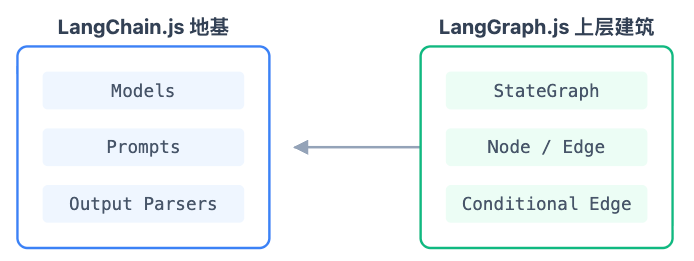
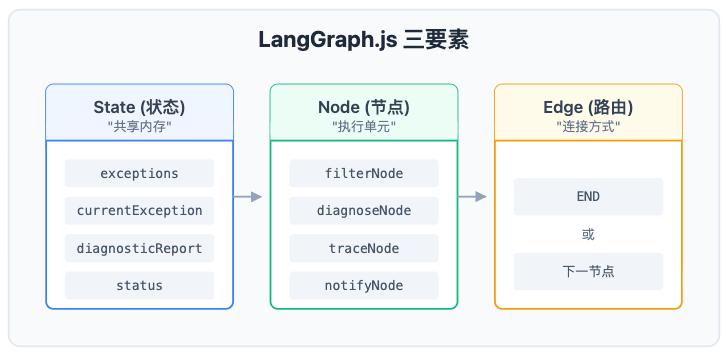
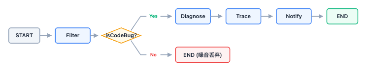

## LangGraph.js 编排思维

### 案例场景引入

 —— **异常告警分流问题**

"我们团队的线上系统每天产生大量异常告警。打开公司的 IM，你会发现——

-  90% 是**噪音**：爬虫扫描产生的 403、网络波动导致的超时、第三方 SDK 的偶发报错
-  10% 是**真 Bug**：代码逻辑错误、空指针、数据异常

问题是 —— 这 90% 和 10% 混在一起，人工一条条看，精力全耗在噪音上。真正的 Bug 反而被淹没了。"

假设使用 Coze workflow 来实现？可以。但有几个问题：

| 场景                                            | Coze 能做吗             | 做得好吗                         |
| :---------------------------------------------- | :---------------------- | :------------------------------- |
| 预设固定分支（if type=TypeError → 路径 A）      | ✅                       | ✅ 但太死板——新类型的异常怎么办？ |
| **LLM 动态判断**是噪音还是 Bug → 再决定走哪条路 | ❌ 不支持运行时 LLM 决策 | —                                |
| 诊断结果（文件名、行号、负责人）跨节点传递      | ⚠️ 全局变量，无类型约束  | 结构化数据传递容易出错           |
| 诊断失败 → 重试 → 用不同策略再诊断              | ❌ 不支持循环            | —                                |

**一句话总结**：Coze 的分支是 **画死在画布上的 if/else**；我们需要的是 **运行时由 LLM 动态决策的条件路由**。

拖拽是可视化线性链；Agent 需要的是 **状态机**。

### LangChain.js 基础三件套

**为什么先讲 LangChain**

> LangGraph.js 构建在 LangChain.js 之上。你不需要精通 LangChain 的全部 API —— 但有三个概念是 LangGraph 的地基。



#### Models — LLM 的统一连接器

```TypeScript
import { ChatOpenAI } from "@langchain/openai";

const model = new ChatOpenAI({ 
  temperature: 0,    // 确定性输出
  modelName: "gpt-4o-mini"
});
```

> LangChain 做的第一件事：把不同 LLM 供应商（OpenAI、DeepSeek、本地 Ollama）包装成统一接口。你换模型只需要改一行。

#### Prompts — 给 LLM 的指令

```TypeScript
const prompt = `请判断该异常是否为代码 Bug：
${exception.message}
Stack: ${exception.stack}`;
```

> 阶段 1 提到 System Prompt 是 Agent 的'人格宪法'。在代码里，Prompt 就是这样一段字符串 —— 你把它传给 LLM，LLM 基于它做判断。
>
> 注意：Prompt 的质量直接决定 Agent 的判断质量。在真实项目中，这行字符串可能需要迭代几十次。

#### Zod + Output Parsers — 让 LLM 输出可信赖的数据

> 来源：Zod 官方文档 https://zod.dev/

*补充：在 python 下扮演 ‘zod’ 类似角色的组件是 ‘Pydantic’。*

#### 案例解析

"LLM 输出的是文本 —— 一段自然语言。比如你问它'这是不是 Bug？'，它可能回答：

- '是的，这是一个 TypeError Bug'
- '我认为这是一个代码层面的问题'
- 'True'
- 三种回答，你都要用正则去解析？太脆弱了。"

```TypeScript
// 因此可以通过 Zod Schema 来解决

import { z } from "zod";

// 定义你期望的输出结构
const schema = z.object({
  isCodeBug: z.boolean().describe("是否为应用代码层面的 Bug"),
  reason: z.string().describe("判断理由")
});

// 绑定到 LLM
const structuredModel = model.withStructuredOutput(schema);

// 调用 —— 返回值自动符合 schema
const result = await structuredModel.invoke(prompt);
// result: { isCodeBug: true, reason: "检测到 TypeError 堆栈" }
```

Zod 是 TypeScript 生态的 schema 验证标准。`withStructuredOutput(zodSchema)` 是 LangChain.js 提供的魔法 —— 它把 Zod Schema 注入到 LLM 的 Function Calling 参数里，强制 LLM 按你的 Schema 输出。

从此以后，LLM 的输出不再是'可能正确的文本'，而是 **结构化的、类型安全的数据**。这是 Agent 工程化的关键一步。

> 没有 Zod 的 LLM = 一个说话随心所欲的同事——你永远不知道他会给你什么格式的数据。
>
> 有 Zod 的 LLM = 一个填表的同事 —— 你给它一张表，它按格子填。

阶段 1 提到的 Function Calling —— LLM 输出 JSON 描述它想调什么工具。Zod + `withStructuredOutput` 就是 Function Calling 的 TypeScript 工程实现。

### LangGraph.js 核心模型

#### Chain 为什么不够用

> 阶段 2 在 Coze 里拖过 workflow —— 那是一种线性链。LangChain.js 也有 Chain。但 Chain 有三个致命缺陷：

| 问题      | LangChain                  | LangGraph                          |
| :-------- | :------------------------- | :--------------------------------- |
| 条件分支  | 不支持或 hack 实现         | Conditional Edges — 运行时动态决策 |
| 状态管理  | 无 — 变量靠手动传参        | State — 显式定义、节点间自动传递   |
| 循环/重试 | 原生不支持（需 hack 实现） | Edge 可以指回已执行的 Node         |

> 来源：LangGraph.js 官方文档 https://langchain-ai.github.io/langgraphjs/
>
> 回忆阶段 1 中的 ReAct 循环？感知→思考→行动→反馈→感知……这是**循环**。Chain 只能通过 while 循环实现循环，LangGraph 可以直接指回已执行的 Node 实现循环/重试。

**LangChain.js**

```typescript
import { ChatOpenAI } from "@langchain/openai";
import { PromptTemplate } from "@langchain/core/prompts";
import { StringOutputParser } from "@langchain/core/output_parsers";

const model = new ChatOpenAI();

// 1. 定义两个独立的 Chain（地基组件）
const checkChain = PromptTemplate.fromTemplate("判断是否是脏话，只回答 true 或 false: {text}")
  .pipe(model)
  .pipe(new StringOutputParser());

const translateChain = PromptTemplate.fromTemplate("翻译成英文: {text}")
  .pipe(model)
  .pipe(new StringOutputParser());

// 2. 运行时：必须用原生的 if/else 强行把两个 Chain 拼起来
async function run(text: string) {
  const isBad = await checkChain.invoke({ text });
  
  if (isBad === "true") {
    return "拒绝回答";
  } else {
    return await translateChain.invoke({ text });
  }
}
```

**LangGraph.js**

```typescript
import { StateGraph, START, END, Annotation } from "@langchain/langgraph";

// 1. 定义状态（共享内存）
const State = Annotation.Root({
  text: Annotation<string>(),
  isBad: Annotation<boolean>(),
  result: Annotation<string>()
});
// 2. 定义节点（复用 LangChain 的能力）
async function checkNode(state: typeof State.State) {
  // 内部依然调用 LangChain 的 model
  const res = await model.invoke(`判断是否是脏话，只回答 true 或 false: ${state.text}`);
  return { isBad: res.content === "true" }; // 更新状态
}
async function translateNode(state: typeof State.State) {
  const res = await model.invoke(`翻译成英文: ${state.text}`);
  return { result: res.content }; // 更新状态
}
// 3. 编排图（上层建筑）
const workflow = new StateGraph(State)
  .addNode("check", checkNode)
  .addNode("translate", translateNode)
  .addEdge(START, "check")
  // 核心差异：条件路由（Conditional Edge）
  .addConditionalEdges("check", (state) => state.isBad ? END : "translate")
  .addEdge("translate", END);
const app = workflow.compile();
// 4. 运行
const finalState = await app.invoke({ text: "你好" });
```

思考：如何对以上两个链进行改造，实现 Agent loop。

> 要把上面’单次分支‘的 StateGraph 改造成 **Agent Loop**，核心变化是把一次性条件路由改成 **循环回边**，并引入 **工具调用**。
>
> Agent Loop 的典型模式是 **ReAct 风格**：模型决定调用工具 → 执行工具 → 把结果塞回消息列表 → 模型基于新上下文再决策 → 循环，直到模型不再调用工具为止。

#### 三要素：State（状态） / Node（节点） / Edge（边）



**State — Agent 的共享内存/状态**

```TypeScript
export const GraphState = Annotation.Root({
  // 待处理异常
  exceptions: Annotation<any[]>({ reducer: (x, y) => y ?? x, default: () => [] }),
  // 当前正在处理的异常
  currentException: Annotation<any | null>({ reducer: (x, y) => y ?? x, default: () => null }),
  // 诊断报告
  diagnosticReport: Annotation<any | null>({ reducer: (x, y) => y ?? x, default: () => null }),
  // 流水线状态
  status: Annotation<string>({ reducer: (x, y) => y, default: () => "idle" }),
});
```

State 是所有节点共享的数据结构。注意 —— 这不是全局变量。它有 **类型**（Annotation），有 **合并规则**（reducer），有 **默认值**。

> `reducer: (x, y) => y ?? x` 意思是：新值覆盖旧值，但如果新值是 null/undefined 则保留旧值。
>
> 打个比方 —— State 就是 Agent 的'共享白板'。每个节点做完自己的事，把结果写在白板上；下一个节点来了，读白板上的内容，继续做。

思考：state 作为 Agent 上下文管理的一个关键单元，它会被直接传递给 LLM 大模型吗？

> **不会直接传递。** 把 State 整体扔给 LLM 是一个常见误解，而且往往正是 Agent 上下文膨胀、token 浪费、模型被噪音干扰的根源。
>
> **State 是运行时容器，LLM 上下文是提示词；节点函数是两者之间的“投影器”（projector）。**State 里有 100 个字段，不代表 LLM 能看到 100 个字段。每个节点只把**当前任务需要的那部分** 投影成自然语言/消息，再传给模型。

**Node — 做事的单元**

```TypeScript
async function filterNode(state: typeof GraphState.State) {
  // 1. 从 State 读取数据
  const ex = state.exceptions[0];
  // 2. 执行逻辑（调用 LLM / 解析 / 计算）
  const res = await structuredModel.invoke(`判断是否为 Bug: ${ex.message}`);
  // 3. 返回 State 更新
  return {
    currentException: res.isCodeBug ? ex : null,
    status: res.isCodeBug ? "diagnosing" : "filtered"
  };
}
```

每个 Node 是一个纯函数：读 State → 做事 → 返回 State 更新。节点之间 **不直接通信** —— 只通过 State 间接传递。这保证了节点的独立性和可测试性。

**Edge — 决定走向的路由**

```TypeScript
// 普通边：固定路径
.addEdge("diagnose", "trace")   // diagnose 做完 → 必然到 trace

// 条件边：动态决策
.addConditionalEdges("filter", (state) => 
  state.currentException ? "diagnose" : END  // 有真 Bug → 诊断；没有 → 结束
)
```

普通 Edge 就是直线 —— A 做完做 B。

**条件 Edge 才是 LangGraph 的灵魂** —— 它在运行时检查 State，动态决定下一步走哪条路。

这和 Coze 的'画死在画布上的 if/else'本质不同：Coze 的分支条件是 **预设的**；LangGraph 的条件是 **运行时由 State 决定的**。在我们的场景里，这个 State 是 LLM 的判断结果 —— 也就是说，**路由决策是由 LLM 做的**。

#### ReAct 循环的工程实现

> 阶段 1 中的 ReAct 循环 —— 感知→思考→行动→反馈。对应如下：

- **感知** = Node 从 State 读取数据
- **思考** = Node 内部调用 LLM 推理
- **行动** = Node 执行操作（写文件、调 API）
- **反馈** = Node 返回 State 更新 → 触发下一个 Node

LangGraph.js 就是 ReAct 循环的 **工程实现**。阶段 1 中看的是概念，阶段 3 中开始写代码。

### 实践 - 异常分析处置 Agent

> 我们团队需要一个 Agent 来自动处理线上异常告警。核心逻辑如下：

1. **Filter**：分类 —— 噪音丢弃，真 Bug 继续

2. **Diagnose**：解析堆栈，定位文件和行号

3. **Trace**：关联 Git 记录，找到引入者（严格的说是 Git Trace）

4. **Notify**：通知负责人，附带诊断报告

#### Step 1: 定义 State

```TypeScript
import { Annotation } from "@langchain/langgraph";

export const GraphState = Annotation.Root({
  // 待处理异常列表
  exceptions: Annotation<any[]>({
    reducer: (x, y) => y ?? x,
    default: () => [],
  }),
  // 当前正在处理的异常（Filter 节点设置）
  currentException: Annotation<any | null>({
    reducer: (x, y) => y ?? x,
    default: () => null,
  }),
  // 诊断报告（Diagnose 设置，Trace 补充）
  diagnosticReport: Annotation<any | null>({
    reducer: (x, y) => y ?? x,
    default: () => null,
  }),
  // 流水线状态
  status: Annotation<string>({
    reducer: (x, y) => y,
    default: () => "idle",
  }),
});
```

**要点**：先定义 State —— Agent 的'共享白板'。

四个字段：

- `exceptions`：待处理异常列表，输入数据
- `currentException`：Filter 节点判断后设置——有值说明是真 Bug，null 说明是噪音
- `diagnosticReport`：诊断报告，在 Diagnose 和 Trace 之间传递
- `status`：流水线状态机的状态

注意 `reducer` —— 这是 State 和普通变量的区别。reducer 定义了'当两个节点同时更新同一个字段时怎么合并'。现在用 `(x, y) => y ?? x` 是最简单的覆盖策略。

#### Step 2: Filter 节点 — 决策点

```TypeScript
import { ChatOpenAI } from "@langchain/openai";
import { z } from "zod";

// 有 API Key 用真实 LLM，没有则用 Mock
const model = process.env.OPENAI_API_KEY
    ? new ChatOpenAI({
        model: process.env.OPENAI_MODEL,
        apiKey: process.env.OPENAI_API_KEY,
        temperature: 0
    }) : {
        withStructuredOutput: (schema: any) => ({
            invoke: async (input: string) => {
                console.log("[Mock Mode] 无 API Key，按预设逻辑分流。");
                return input.includes("TypeError")
                    ? { isCodeBug: true }
                    : { isCodeBug: false };
            }
        })
    } as any;

async function filterNode(state: typeof GraphState.State) {
  console.log("\n[Node: Filter] 检查异常类型...");
  const ex = state.exceptions[0];

  // 用 Zod 定义输出 schema
  const schema = z.object({
    isCodeBug: z.boolean().describe("是否为代码 Bug"),
  });

  // withStructuredOutput 强制 LLM 按 schema 输出
  const res = await model
    .withStructuredOutput(schema)
    .invoke(`判断是否为代码 Bug: ${ex.type}`);

  return {
    currentException: res.isCodeBug ? ex : null,    // 决定后续路径
    exceptions: state.exceptions.slice(1),          // 消费掉已处理的异常
    status: res.isCodeBug ? "diagnosing" : "filtered",
  };
}
```

**要点**：Filter 是整个 Agent 最关键的节点 —— 它决定后续走哪条路。

注意 `z.object({ isCodeBug: z.boolean() })` —— 在前面提到的 Zod，LLM 的输出被强制约束为布尔值。没有这个，LLM 可能返回'我认为这可能是一个潜在的代码问题' —— 此时又该如何解析？

Mock 模式下我们用简单规则：type 为 'TypeError' 就是 Bug。真实场景中，LLM 会分析 message 和 stack trace 来判断。

> 关键是返回值：
>
> `currentException` 如果有值，说明是真 Bug —— 后续走 Diagnose；
>
> 如果是 null —— 说明是噪音 —— 直接结束。**这个返回值就是条件路由的决策依据。**

思考：这样设计的经济性是不是会有问题？

1. **逐条调用** → 固定开销重复支付 N 次，是最大浪费；改批量可省 60–70% token 和大量 RTT。
2. **大模型做二分类** → 显式用小模型，配合规则粗筛，再省一个数量级。
3. **工程细节** → Runnable 复用、重试、边界、缓存。

一句话：**Filter 应该是“廉价但足够准的 gatekeeper”，当前设计是“昂贵且未必准的 gatekeeper”。** 先改调用粒度，再改模型选型，最后补准确率，顺序不要反 —— 批量化的收益最大，改动也最局部。

#### Step 3: Diagnose + Trace — 状态流动

```TypeScript
async function diagnoseNode(state: typeof GraphState.State) {
  console.log("[Node: Diagnose] 提取堆栈信息...");
  const ex = state.currentException!;  // 读取 Filter 设置的值

  // 从堆栈中提取文件名和行号
  const fileMatch = ex.stack.match(/at\s+(.+)\s+\((.+):(\d+):(\d+)\)/);
  const file = fileMatch ? fileMatch[2] : "unknown";

  return {
    diagnosticReport: { file, introductionVersion: ex.bundleId }
  };
}

async function traceNode(state: typeof GraphState.State) {
  console.log("[Node: Trace] 关联 Git 记录...");
  const report = state.diagnosticReport!;  // 读取 Diagnose 设置的值

  // Mock: 从预置的 Git 日志中查找
  const git = MOCK_GIT_LOGS[report.file] || { author: "System" };

  return {
    diagnosticReport: {
      ...report,
      author: git.author,
      reason: `由 ${git.author} 引入`
    }
  };
}
```

**要点**：

`Diagnose` 读取 `state.currentException` —— 这是 Filter 设置的。它从堆栈中正则提取文件名和行号。

`Trace` 读取 `state.diagnosticReport` —— 这是 Diagnose 设置的。它用文件名去查 Git 记录，找到引入这个 Bug 的人。

**可以看到，Diagnose 和 Trace 之间没有直接传参，它们通过 State 通信。** Diagnose 写入 `diagnosticReport`，Trace 从 `diagnosticReport` 读取。

这就是'状态在节点间流动' —— 不是函数调用，不是全局变量，是 State 这个'共享白板'。

#### Step 4: Notify 节点 + 构图

```TypeScript
async function notifyNode(state: typeof GraphState.State) {
  const report = state.diagnosticReport!;
  console.log(`[告警] 发现真 Bug！负责人: ${report.author}, 位置: ${report.file}`);
  return { status: "notified" };
}
```

**流程构图**：

```TypeScript
import { StateGraph, START, END } from "@langchain/langgraph";

const workflow = new StateGraph(GraphState)
  .addNode("filter", filterNode)
  .addNode("diagnose", diagnoseNode)
  .addNode("trace", traceNode)
  .addNode("notify", notifyNode)
  .addEdge(START, "filter")               // 入口
  .addConditionalEdges("filter", (s) =>   // 条件路由
    s.currentException ? "diagnose" : END
  )
  .addEdge("diagnose", "trace")      // 固定路径
  .addEdge("trace", "notify")        // 固定路径
  .addEdge("notify", END);           // 出口

export const app = workflow.compile();
```

**要点**：

最后一步 —— 构图。把四个节点和五条边连起来。

注意：`.addConditionalEdges("filter", (s) => s.currentException ? "diagnose" : END)`这就是 LangGraph 的灵魂。Filter 做完后，检查 State：有 `currentException` → 走 Diagnose；没有 → 直接 END。

> **这个路由决策是运行时做的，不是预设的。** 如果我们用 LLM 而不是 Mock，路由决策就是 LLM 做的 —— 一个'会思考的路由'。
>
> **还记得开头说的 Coze 吗？** Coze 的分支是'画死在画布上的 if/else' —— 你在设计时就决定了所有路径。你现在写的这一行，是 **运行时由 LLM 动态决策** 的条件路由。
>
> **这就是从拖拽到代码的真正跨越。** 不是把拖拽变成代码，而是获得了拖拽永远给不了你的能力 —— 动态决策。

**流程图**：



#### Step 5: 运行演示

```Bash
# 根目录下
pnpm lesson-03
```

**预期输出**：

```Plain
🚀 异常处理 Agent 启动...

>>> 正在处理异常: ex_101 (TypeError)

[Node: Filter] 检查异常类型...
[Mock Mode] 无 API Key，按预设逻辑分流。
[Node: Diagnose] 提取堆栈信息...
[Node: Trace] 关联 Git 记录...
[告警] 发现真 Bug！负责人: Li Si, 位置: src/services/CartService.ts

>>> 正在处理异常: ex_102 (WebScannerError)

[Node: Filter] 检查异常类型...
[Mock Mode] 无 API Key，按预设逻辑分流。
(filtered — 噪音丢弃，流程结束)
```

**两条路径对比**：

同一次运行，两条完全不同的路径：

ex_101（TypeError）→ Filter: 是 Bug → Diagnose → Trace → Notify → END

ex_102（WebScannerError）→ Filter: 是噪音 → END

\> 这就是**条件路由**。同样的图、同样的代码 —— 不同的输入，走不同的路径。

### 总结

**学习了 LangChain.js 三件套** —— Models、Prompts、Zod Output Parsers。这是 LLM 调用的基础设施。

**学习了 LangGraph.js 的三要素** —— State（共享内存）、Node（执行单元）、Edge（条件路由）。这是 Agent 编排的通用语言。

**写了一个完整的异常分析 Agent** —— Filter → Diagnose → Trace → Notify，带条件分支。

注意：此示例 Agent 是对大厂异常分析、分配 Agent 的一个简化版本，在实践中都会配合公司基建进行相应的架构及策略设计。比如，异常分拣环节通常先过一道分拣算法（包含正则模板匹配结果、告警量、核心链路、态势变化等因子的统计学算法）

#### 实际行动

**① 改造实验**

> 把 Mock 数据换成你自己的异常 —— 找一个你项目里真实的 Error，替换 `MOCK_EXCEPTIONS`，看看 Agent 怎么处理。

**② 为阶段 4 做准备**

> 阶段 4 需要做两件事：
>
> - 用 RAG 替换 Mock 的 Git 日志 —— 真正从代码仓库检索提交记录
> - 用 MCP Server 替换 Mock 的通知 —— 真正发送告警到飞书/钉钉
> - 当前的 Mock 数据，就是阶段 4 的'替换靶心'。

#### 附录 A：关键来源

| 来源                  | 链接                                        | 类型     |
| --------------------- | ------------------------------------------- | -------- |
| LangGraph.js 官方文档 | https://langchain-ai.github.io/langgraphjs/ | 官方     |
| Zod 官方文档          | https://zod.dev/                            | 官方     |
| pnpm Workspaces       | https://pnpm.io/workspaces                  | 官方     |
| Sentry 可观测性实践   | https://sentry.io/resources/                | 行业参考 |

